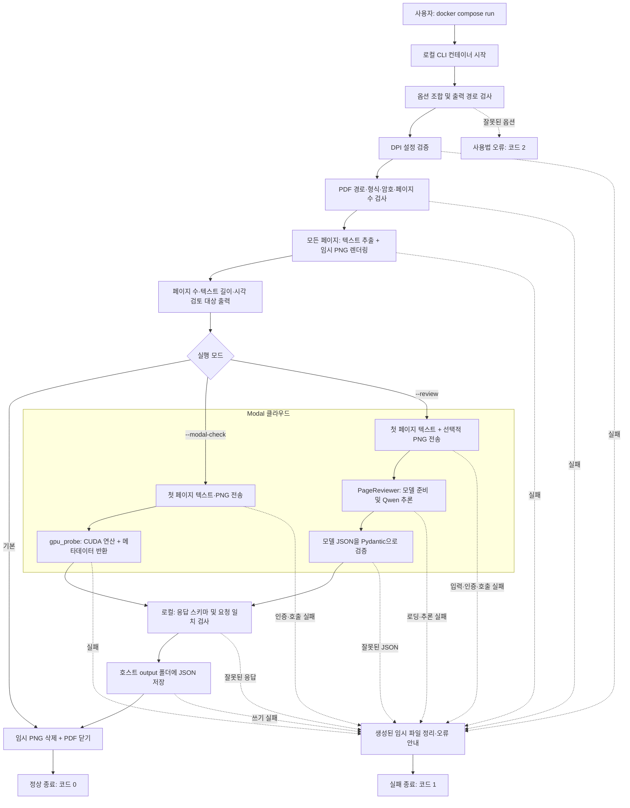
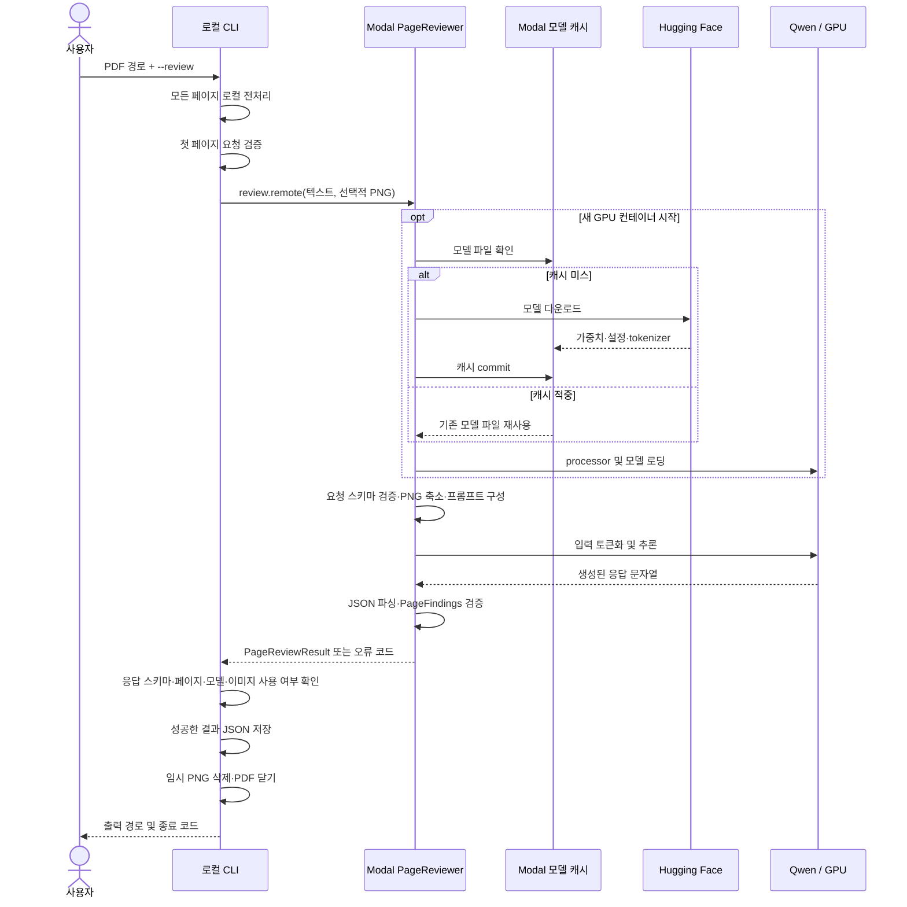

# CLI 실행 흐름

파일과 함수 단위의 상세 설명은 [실행 순서로 읽는 코드](code-walkthrough.md)를 참고하세요.

이 문서는 현재 구현을 기준으로 CLI 실행부터 결과 저장과 종료까지 설명합니다. **모든 페이지를 로컬에서 전처리하지만, 클라우드로 보내 검토하는 것은 첫 페이지뿐입니다.**

## 1. 실행 방법과 모드

프로젝트 디렉터리에서 실행합니다. Docker 이미지 빌드, Modal 인증·배포 방법은 [README](../README.md)를 참고하세요. 로컬 전처리만 사용할 때에는 Modal 인증이나 배포가 필요하지 않습니다.

| 목적 | 옵션 | 클라우드 작업 | 결과 |
| --- | --- | --- | --- |
| PDF 전처리 확인 | 없음 | 없음 | 터미널 요약만 출력 |
| GPU 연결 확인 | `--modal-check` | PNG 확인 및 CUDA 연산 `2² = 4` | GPU 연결 검사 JSON |
| 이미지 포함 AI 검토 | `--review` | 첫 페이지 텍스트·이미지로 Qwen 추론 | 미검증 페이지 검토 JSON |
| 텍스트 전용 AI 검토 | `--review --text-only` | 첫 페이지 텍스트로 Qwen 추론 | 미검증 페이지 검토 JSON |

```bash
# 로컬 전처리만 실행
docker compose run --rm exam-checker /data/sample.pdf

# Modal에서 첫 페이지 검토
docker compose -f docker-compose.yml -f docker-compose.modal.yml run --rm \
  exam-checker /data/sample.pdf --review \
  --output /output/sample.page-review.json
```

위 AI 검토 명령에서 `--review`를 `--modal-check`로 바꾸면 GPU 연결 검사입니다. 텍스트 전용 검토는 `--review`와 함께 `--text-only`를 추가합니다. 이 모드도 현재는 로컬에서 모든 페이지의 PNG를 생성하지만, 이미지를 클라우드에 보내지는 않습니다.

## 2. 전체 흐름



점선은 주요 실패 경로입니다. 임시 파일 정리는 Python 컨텍스트가 정상적으로 해제되는 성공·예외 종료에 적용됩니다. 프로세스 강제 종료 등에서는 Python 정리 코드의 실행을 보장하지 않습니다. Docker의 `--rm`은 실행 후 로컬 컨테이너를 제거합니다.

## 3. 로컬에서 일어나는 일

### 컨테이너와 파일 경로

Compose가 `python -m exam_checker.cli`를 실행하며, Typer가 인자를 해석합니다.

| 호스트 | 컨테이너 | 용도 |
| --- | --- | --- |
| 프로젝트 폴더 | `/app` | 소스 코드, 읽기 전용 |
| `data/` | `/data` | 입력 PDF, 읽기 전용 |
| `output/` | `/output` | 결과 JSON 저장 |
| `~/.modal.toml` | `/root/.modal.toml` | 추가 Compose 파일 사용 시 인증 파일, 읽기 전용 |

따라서 호스트의 `data/exam.pdf`는 CLI에 `/data/exam.pdf`로 전달합니다. `--output /output/exam.page-review.json`의 결과는 호스트의 `output/exam.page-review.json`에서 확인합니다.

### 옵션과 설정 검사

- `--modal-check`와 `--review`는 동시에 사용할 수 없습니다.
- `--model`, `--text-only`는 `--review`와 함께 사용합니다.
- `--output`은 `--modal-check` 또는 `--review`가 있을 때만 사용합니다.
- 입력 PDF와 같은 출력 경로는 거부합니다.

| 설정 | 우선순위 또는 적용 시점 |
| --- | --- |
| 렌더 DPI | `--dpi` → `EXAM_CHECKER_RENDER_DPI` → `160`. 허용 범위 72–300 |
| 모델 ID | `--model` → `EXAM_CHECKER_MODEL` → `Qwen/Qwen3-VL-8B-Instruct` |
| Modal 앱 이름 | `EXAM_CHECKER_MODAL_APP`, 기본 `exam-checker`. 배포·호출 값이 같아야 함 |
| GPU 종류 | `EXAM_CHECKER_GPU`, 기본 `L4`. 배포 시 결정되므로 변경 후 재배포 필요 |

Compose는 프로젝트의 `.env` 값을 위 환경변수에 반영합니다. Python CLI를 직접 실행할 때에는 `.env`를 자동으로 읽지 않으므로 환경변수를 별도로 설정해야 합니다.

### PDF 전처리

1. 파일 존재 여부와 `.pdf` 확장자를 확인합니다.
2. PyMuPDF로 열어 PDF 형식, 암호 필요 여부, 페이지 수를 확인합니다.
3. 임시 디렉터리를 만들고 **모든 페이지**를 순서대로 처리합니다.
4. 페이지에서 네이티브 텍스트를 추출하고 지정한 DPI로 PNG를 렌더링합니다. OCR은 실행하지 않습니다.
5. 페이지 번호·텍스트·이미지 경로·`needs_visual_review`를 `PageData`에 담습니다.
6. 페이지별 텍스트 길이와 전체 요약을 출력합니다.

`needs_visual_review`는 문자·숫자가 20자 미만이면 설정됩니다. 이는 스캔 여부의 확정 판정도, 클라우드 호출을 결정하는 조건도 아닙니다. 기본 모드에서는 이 단계 이후 바로 임시 파일을 정리하고 종료합니다.

## 4. AI 검토 모드의 상세 흐름



차트의 결과 저장 경로는 성공한 경우입니다. 입력 또는 모델 응답 검증이 실패하면 결과를 저장하는 대신 오류 종료합니다.

### 첫 페이지 요청 생성

`review_page()`는 `pages[0]`의 텍스트를 사용합니다. 기본 AI 검토에서는 PNG 파일의 바이트도 읽어 보냅니다. `--text-only`에서는 `image_png`를 `None`으로 보내며, 추출된 텍스트가 비어 있으면 호출 전에 실패합니다. 원본 PDF와 나머지 페이지는 보내지 않습니다.

로컬 요청 검증 한도는 텍스트 30,000자, PNG 20,000,000바이트입니다. Modal SDK는 배포된 앱의 `PageReviewer`를 모델 ID로 생성하고 `review.remote()`를 호출합니다. CLI 실행이 자동으로 앱을 배포하지는 않습니다.

### 모델 준비와 추론

새 컨테이너에서는 `@modal.enter()`의 `load()`가 한 번 실행됩니다. `snapshot_download()`가 `/model-cache`의 파일을 재사용하거나 다운로드하고, Volume에 반영한 뒤 모델을 GPU로 올립니다. 가중치가 캐시되어 있어도 새 컨테이너에서는 GPU 메모리 로딩이 필요합니다. 이미 모델을 올린 컨테이너를 재사용하면 이 로딩 단계를 건너뜁니다.

검토 요청마다 다음 작업을 수행합니다.

1. PNG를 받았다면 RGB로 변환하고 긴 변이 최대 1,280픽셀이 되도록 축소합니다.
2. 검토 지시, 응답 JSON 스키마, 페이지 데이터를 프롬프트로 구성합니다.
3. processor로 텍스트와 이미지를 모델 입력으로 변환합니다.
4. 전체 입력이 8,192토큰을 넘으면 실패합니다. 자동으로 자르거나 여러 요청으로 나누지 않습니다.
5. GPU에서 최대 2,048토큰을 생성합니다. 현재 `do_sample=False`입니다.
6. 응답 전체를 JSON으로 파싱하고 `PageFindings` 스키마로 검증합니다. 하나의 JSON 코드 블록으로 감싼 응답도 허용하지만, 깨진 JSON을 추측해 복구하지 않습니다.

현재 모델 호출은 단일 검토입니다. 잘못된 JSON을 다시 생성하게 하는 루프, 의심 항목의 독립 재검증, 전체 시험지 검토는 아직 없습니다.

## 5. GPU 연결 검사 모드

`--modal-check`는 첫 페이지의 텍스트·PNG를 `gpu_probe`에 보냅니다. 텍스트 한도는 200,000자이며 PNG 한도는 20,000,000바이트입니다.

Modal에서는 PNG를 열어 크기를 확인하고 CUDA에서 `2² = 4`를 계산합니다. GPU 이름·이미지 크기·텍스트 길이 등을 반환하면 로컬에서 스키마와 페이지 번호·텍스트 길이를 검사합니다. 이 경로에서는 Qwen 모델을 로딩하거나 시험 내용을 검토하지 않습니다.

## 6. 결과 저장과 읽는 방법

`--output`을 생략하면 작업 디렉터리 아래의 다음 경로를 사용합니다. 현재 Compose에서는 `/app/output`이 호스트의 `output/`과 연결됩니다.

| 모드 | 기본 파일 |
| --- | --- |
| `--modal-check` | `output/<PDF 이름>.gpu-check.json` |
| `--review` | `output/<PDF 이름>.page-review.json` |
| 기본 전처리 | 저장 파일 없음 |

`--output`은 접두사가 아닌 **정확한 파일 경로**입니다. 확장자를 자동 보정하지 않으므로 `.jso`로 지정하면 그대로 저장합니다. 같은 경로의 파일이 있으면 성공 시 덮어씁니다. 쓰기 작업은 원자적 교체 방식이 아니므로 쓰기 도중의 오류에는 부분 파일이 남을 수 있습니다.

AI 검토 JSON의 주요 필드는 다음과 같습니다.

| 필드 | 의미 |
| --- | --- |
| `kind` | `unverified_page_review`: 독립 재검증 전 결과 |
| `scope` | `first_page_only`: 첫 페이지만 검토 |
| `model`, `page_number`, `image_used` | 사용한 모델과 실제 요청 범위 |
| `review.summary` | 모델이 작성한 요약 |
| `review.issues` | 유형·심각도·설명·근거·제안·신뢰도를 포함한 의심 항목 |
| `review.issues[].verified` | 현재 항상 `null` |
| `review.limitations` | 모델이 보고한 자료 부족 등의 한계 |

**종료 코드 0은 처리와 저장의 성공이지 시험지가 정상이라는 뜻이 아닙니다.** Pydantic은 결과 형식과 필드 제약을 검사하며 수학적 정답이나 근거의 진위를 검증하지 않습니다. 실제 합성 샘플에서 오탐과 오류 누락이 모두 관찰됐으므로 `issues: []`나 높은 `confidence`도 정확성을 보장하지 않습니다.

## 7. 실패와 데이터 수명

| 상황 | 동작 |
| --- | --- |
| 잘못된 옵션 조합·입력과 같은 출력 경로 | 처리 시작 전 사용법 오류, 종료 코드 2 |
| 잘못된 DPI 환경변수·PDF 오류 | 오류 안내, 종료 코드 1 |
| 인증 실패·미배포 앱·모델 로딩 실패·타임아웃 | 클라우드 오류 안내, 종료 코드 1 |
| GPU 메모리 부족·추론 실패·잘못된 JSON | 새 결과를 저장하지 않고 종료 코드 1 |
| 저장 실패 | 오류 안내, 종료 코드 1; 부분 파일 가능 |

추론이나 응답 검증 단계에서 실패하면 기존 출력 파일은 그대로 남습니다. 이전 파일을 새 결과로 오인하지 않도록 터미널 메시지와 종료 코드를 함께 확인하세요. PDF가 열린 상태에서 예외가 발생해도 컨텍스트가 해제되면 PDF와 임시 PNG를 정리합니다.

| 데이터 | 저장 위치와 수명 |
| --- | --- |
| 원본 PDF | 호스트 `data/`, CLI가 삭제하거나 수정하지 않음 |
| 추출 텍스트 | 로컬 메모리, 첫 페이지 요청 데이터로 선택적 전송 |
| 임시 PNG | 로컬 임시 디렉터리, 컨텍스트 종료 시 삭제 |
| 클라우드 요청 | 워커 메모리에서 처리; 앱 코드가 별도 파일·Volume으로 저장하지 않음 |
| 모델 파일 | Modal `exam-checker-model-cache` Volume에 유지 |
| 결과 JSON | 호스트 출력 경로에 유지; 시험 내용이나 근거가 포함될 수 있음 |

앱 코드는 시험지 본문이나 원시 모델 응답을 로그로 출력하지 않습니다. 위 설명은 앱의 저장 동작이며 Modal 플랫폼 자체의 전송·운영 데이터 보존 정책을 정의하지 않습니다. 모델 컨테이너는 최소 0개, 최대 1개로 설정되어 있으며 30초 유휴 후 종료 대상이 됩니다. 종료되더라도 모델 Volume과 호스트 결과 파일은 남습니다.

## 8. 코드를 찾아볼 때

| 파일 | 담당 작업 |
| --- | --- |
| [cli.py](../exam_checker/cli.py) | 옵션, 실행 분기, 터미널 출력, JSON 저장, 종료 코드 |
| [config.py](../exam_checker/config.py) | DPI 환경변수와 범위 검증 |
| [extractor.py](../exam_checker/pdf/extractor.py) | PDF 검증·열기·텍스트 추출 |
| [pipeline.py](../exam_checker/pdf/pipeline.py) | 모든 페이지 전처리, PageData, 임시 파일 수명 |
| [renderer.py](../exam_checker/pdf/renderer.py) | 페이지 PNG 렌더링 |
| [modal_client.py](../exam_checker/cloud/modal_client.py) | 원격 호출, 오류 변환, 응답 검증 |
| [review_schema.py](../exam_checker/cloud/review_schema.py) | AI 요청·결과 스키마와 JSON 파싱 |
| [schema.py](../exam_checker/cloud/schema.py) | GPU 연결 검사 스키마 |
| [modal_app/app.py](../modal_app/app.py) | Modal 이미지·GPU·캐시·원격 함수와 클래스 |
| [modal_app/model.py](../modal_app/model.py) | 모델 로딩·프롬프트·추론 |

문항 분할, 번호·보기 누락 검사, 정답 키 입력, verifier, 전체 시험지 검토와 Markdown 보고서는 아직 이 실행 흐름에 포함되지 않습니다.
